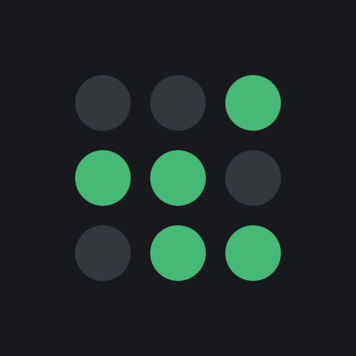

# fitness-dash

A small, mobile-first dashboard for a personal gym log. It reads the
`trainingsdaten.json` file that a Hermes agent keeps
up to date and shows:

- a calendar of training days for the last 12 months, with the details of each workout,
- the duration of each workout, if Hermes knows it,
- workouts this month, weeks in a row with two workouts, volume this week, and
  the average duration of the last eight workouts with a known duration,
- the next workout (A/B alternate) with the last weights and notes per exercise,
- volume per week (weight × reps of all sets) for the last 12 weeks,
- progress per exercise: heaviest weight per workout (longest hold for timed
  exercises), new records, a hint when an exercise has not improved for four
  workouts, and a goal line when a note names a weight ("Nächstes Mal 20 kg").
- a muscle map on its own page (`#muskelkarte`, so it can be bookmarked):
  front and back figure coloured by sets per week and muscle group over the
  last 4, 8 or 12 weeks, details per muscle, and a list of all groups from
  least to most trained. The start page names the three least trained groups
  of the last four weeks.

The dashboard only reads. All numbers are computed in the browser from the
JSON file; there is no database and no backend code. The only exception is the
optional Withings service below, which fetches body weight.

> [!NOTE]
> Personal project, built with AI coding agents under my supervision. Review the code carefully before you use it.

## Run it

Requires Docker with Compose.

```sh
cp .env.example .env    # set DATA_DIR to the directory that holds trainingsdaten.json
docker compose up -d --build
```

The dashboard listens on all interfaces on `PORT` (default 8090). The data
directory is mounted read-only, and only `trainingsdaten.json` is served from
it. There is no login: keep the port inside your LAN or tailnet.

### Install as an app

Browsers install web apps only over HTTPS. Inside a tailnet, Tailscale Serve
provides HTTPS with a valid certificate:

```sh
sudo tailscale serve --bg --https=8443 http://127.0.0.1:8090
```

Then open `https://<machine>.<tailnet>.ts.net:8443` on the phone (with
Tailscale running) and choose "Install app" in Chrome, or "Add to Home Screen"
in Safari. Switching back to the app reloads the data.

The app keeps the last loaded data on the device and, over HTTPS, caches
itself with a service worker, so it also opens without a connection and says
so. The colour scheme follows the device or can be set to light or dark. Remove the proxy with
`sudo tailscale serve --https=8443 off`.

### Weight from Withings (optional)

A small extra container fetches your weight from a Withings scale every 15
minutes and writes it to `gewichtsdaten.json`, separate from the training
data. Without it, the dashboard works as before.

1. Create an app in the [Withings developer portal](https://developer.withings.com/)
   and register the callback URL of your dashboard, for example
   `https://<machine>.<tailnet>.ts.net:8443/withings/callback`.
2. Put its client ID and secret and exactly that callback URL into `.env`
   (see `.env.example`).
3. Start both containers:

   ```sh
   docker compose --profile withings up -d --build
   ```

4. Open `/withings/` on the dashboard, choose "Mit Withings verbinden" and
   allow access. The page then shows the last sync and how many measurements
   were taken over.

Only measurements that Withings surely attributes to your profile count:
those the scale assigned to you and those you entered yourself. Measurements
the scale could not assign to one person are left out until you assign them
to yourself in the Withings app. The tokens stay in the `withings-state`
volume; Caddy serves only `gewichtsdaten.json` from the service.

## Develop

```sh
npm ci
npm run dev             # http://<host>:5173 with sample-data/trainingsdaten.json
DATA_DIR=/path/to/dir npm run dev   # with real data
npm test && npm run lint && npm run typecheck && npm run build
```

`sample-data/` holds fictional data in the same format.

## Data format

The app reads `schema_version` 1 of `trainingsdaten.json`:

- `performance_entries[]`: one entry per exercise and workout, with
  `entry_type` `reported_performance` or `reported_skip`, `workout_date`,
  `session_id`, `plan`, `exercise_id`, `exercise_name`, `plan_position` and
  `sets[]` (`reps`, `weight_kg`, `duration_seconds`, `side`).
- `sessions{}`: workout date, plan, status and `duration_seconds` per session
  (null when the start or end was not reported; such workouts are left out of
  the average).
- `exercise_comments{}`: the current note per exercise.

Entries without a `workout_date` are ignored. Weights are used as reported.

`gewichtsdaten.json` (written by the Withings service, `schema_version` 1)
holds `updated_at` (last successful sync), `timezone` and `measurements[]`
with `measured_at`, the local `date` and `weight_kg`, oldest first.

### Muscle map

The file does not say which muscles an exercise trains. That lives in the
table `EXERCISE_MUSCLES` at the top of `src/lib/model.ts`, keyed by
`exercise_id`, with main and secondary muscles. A set counts 1 for a main
muscle and 0.5 for a secondary one; sets reported per side count once; skipped
entries do not count. The period is the last 4, 8 or 12 × 7 days up to today.

When Hermes logs an exercise that is not in the table, the muscle map names it
as not assigned and leaves it out of the numbers. Add a line to the table to
include it.

## Credits

The body figure of the muscle map uses path data from
[react-native-body-highlighter](https://github.com/HichamELBSI/react-native-body-highlighter)
by ELABBASSI Hicham, MIT License. The full notice is in
`src/lib/body-art.ts`.

## Status

Personal project, built with AI coding agents under my supervision. There is
no support and no stability guarantee; review the code carefully before you
rely on it. See [LICENSE](LICENSE) for the warranty terms.
